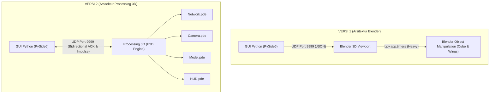

# Dokumentasi Upgrade Simulasi: VERSI 1 vs VERSI 2
**Mata Kuliah: Praktikum Sistem Kontrol Dasar (PSKD)**  
**Proyek: Simulasi Sistem Kendali Balancing Propeller (1-DOF Seesaw)**

---

## 📌 Ringkasan Eksekutif

Proyek simulasi kendali **Balancing Propeller** dirancang untuk memodelkan, mengontrol, dan menganalisis sistem penyeimbang 1 derajat kebebasan (*1-Degree of Freedom Seesaw*) berbasis kendali PID.

Perbedaan fundamental antara **VERSI 1** dan **VERSI 2** terletak pada **teknologi visualisasi 3D** yang digunakan:
* **VERSI 1**: Menggunakan engine visualisasi **Blender 3D** yang dikendalikan melalui skrip Python internal Blender (`bpy`).
* **VERSI 2**: Menggunakan visualizer mandiri berbasis **Processing 3D (P3D)** yang jauh lebih ringan, instan, dan responsif.

Meskipun visualizer 3D di-upgrade sepenuhnya, **antarmuka GUI Python (PySide6) sengaja dipertahankan seragam dan konsisten** agar alur kerja pengujian, tata letak analitik respons, grafik telemetri real-time, dan pengujian skenario otomatis tetap familiar bagi pengguna dan dosen penguji, sembari menghadirkan fitur-fitur baru yang belum ada di VERSI 1.

---

## 📊 Matriks Perbandingan Fitur: VERSI 1 vs VERSI 2

| Parameter / Fitur | VERSI 1 (Blender-Based) | VERSI 2 (Processing-Based) | Catatan / Manfaat Upgrade |
| :--- | :--- | :--- | :--- |
| **Visualizer 3D** | Blender (Scripting `bpy`) | Processing 3D (`P3D`) | P3D membuka dalam 1 detik tanpa dependensi Blender |
| **Konsumsi Resource (RAM)** | ~500 MB – 1.2 GB | ~90 – 160 MB | VERSI 2 sangat ringan, lancar di laptop spesifikasi standar |
| **Frame Rate Rendering** | ~20 – 35 FPS (tergantung viewport Eevee) | Stabil 60 FPS murni | Animasi putaran propeller dan ayunan batang jauh lebih mulus |
| **Protokol UDP** | Satu Arah (Python $\to$ Blender) + ACK | Dua Arah (*Bidirectional* Python $\leftrightarrow$ Processing) | Processing dapat membalas sinyal event (seperti tombol Space) ke Python |
| **Pemicu Impuls Gangguan (*Disturbance*)** | ❌ Belum Ada | ✅ **Tersedia Lengkap** (Tombol UI, Klik Batang 2D, Tombol D, Space di 3D) | Menguji *robustness* PID saat sistem ditabrak torsi mendadak |
| **Vektor Gaya Dorong (*Thrust Vector*)** | ❌ Tidak Ada | ✅ **Panah 3D Dinamis** ($F_1$ & $F_2$) | Menampilkan besar gaya dorong tiap motor secara real-time |
| **Visualisasi Putaran Baling-baling** | Rotasi geometri biasa | **Motion Blur Spinning Disc** dinamis | Efek blur piringan berkecepatan tinggi mengikuti RPM motor |
| **Busur Derajat Sudut (*Protractor Arc*)** | ❌ Hanya ada di 2D | ✅ **Ada di 2D dan 3D** | Skala busur $-30^\circ$ s/d $+30^\circ$ (batas mekanik terukur) dengan jarum aktual & setpoint |
| **Preset Kamera Navigasi** | Mengikuti orbit standar Blender | Tombol `1` (Depan), `2` (Samping), `3` (Atas), `4` (Bawah), `R` (Reset) | Tampilan Depan (1) persis sejajar dengan tampilan 2D GUI |
| **Modularitas Skrip 3D** | 1 file script monolithic (`blender_receiver.py`) | **5 Modul PDE Terpisah** (`Network`, `Camera`, `Model`, `HUD`, `Main`) | Struktur kode terorganisir rapi per fungsi kerja |
| **Kemudahan Eksekusi** | Harus membuka Blender manual $\to$ Text Editor $\to$ Run Script | **1-Klik Launcher** (`run_simulasi.bat` / `run_simulasi.py`) | Otomatis meluncurkan viewer 3D dan GUI Python bersamaan |

---

## 🖥️ Keselarasan Desain GUI Python (Mengapa GUI Dibuat Sama?)

Antarmuka GUI Python pada VERSI 2 mempertahankan tata letak (layout) dan palet tema modern dari VERSI 1 dengan tujuan:

1. **Konsistensi Eksperimen Ilmiah**:
   Parameter kendali PID ($K_p$, $K_i$, $K_d$), input setpoint ($-20^\circ$ s/d $+20^\circ$), slider beban massa (0 – 500 g), posisi beban (5 – 15 cm), dan noise sensor IMU ($\sigma$) berada pada posisi yang identik sehingga hasil perbandingan data antar versi valid.
2. **Visualisasi Dual-View Terpadu**:
   Panel kiri menampilkan **Representasi Fisik 2D (`BeamView`)** yang menyajikan side-view batang, garis rumput acuan, busur derajat, dan vektor gaya motor secara presisi.
3. **Analitik Respon Transien Otomatis**:
   Enam metrik respons kendali (*Overshoot $M_p$*, *Rise Time $t_r$*, *Peak Time $t_p$*, *Settling Time $t_s$ 2%*, *Steady-State Error $e_{ss}$*, dan *Peak Deviation*) tetap dihitung otomatis pada buffer data event.
4. **Automated Scenario Runner**:
   Fitur pengujian otomatis 6 skenario step dan load disturbance tetap tersedia dan dapat dijalankan dengan sekali klik.

---

## 🚀 Fitur Baru yang Di-upgrade pada GUI & Backend di VERSI 2

Meskipun basis GUI identik, VERSI 2 menambahkan penyempurnaan signifikan pada interaksi kendali:

### 1. Sistem Pengujian Gangguan Impuls Torsi (*Disturbance Impulse Robustness*)
Di VERSI 1, pengujian gangguan hanya dapat dilakukan dengan menggeser slider beban secara perlahan (gangguan statis). Pada VERSI 2, diimplementasikan pengujian **gangguan impuls transien mendadak** ($\Delta \omega = \pm 2.5\text{ rad/s}$):
* **Tombol Cepat GUI**: Tombol merah `💥 Sentak Gangguan (Impuls)` di panel kontrol kanan.
* **Interaksi Langsung pada Batang 2D**: Pengguna dapat **mengklik sisi kiri** batang (memberi sentakan positif ke atas) atau **mengklik sisi kanan** batang (memberi sentakan ke bawah).
* **Shortcut Keyboard**:
  * Tekan tombol **`D`**: Sentakan impuls torsi positif (+2.5 rad/s).
  * Tekan tombol **`Shift + D`**: Sentakan impuls torsi negatif (-2.5 rad/s).
* **Integrasi Lintas Aplikasi (Processing $\to$ Python)**:
  * Pengguna cukup mengklik jendela Processing 3D lalu menekan tombol **`[SPACE]`**. Sinyal UDP `b"impulse"` akan otomatis dikirimkan balik ke Python, memicu respon impuls dan langsung mencatat metrik pemulihan (*peak deviation* & *recovery settling time*).

### 2. Status Konektivitas UDP Dua Arah (ACK Heartbeat)
* **VERSI 1**: Widget pill status menampilkan `BLENDER · connected / no listener`.
* **VERSI 2**: Menggunakan `ProcessingStream` dengan protokol handshaking ACK dua arah:
  * 🟢 **PROCESSING · connected**: Processing aktif dan secara nyata membalas paket dengan `b"ack"`.
  * 🟡 **PROCESSING · no ACK**: Paket terkirim tetapi belum ada balasan.
  * 🔴 **PROCESSING · no listener**: Port 9999 belum dibuka oleh Processing.

---

## 🎨 Arsitektur Visualizer 3D: Blender vs Processing 3D



### Mengapa Processing 3D Lebih Unggul untuk Proyek Ini?
1. **Portabilitas Penuh**: Processing tidak memerlukan software 3D suite berukuran gigabyte seperti Blender.
2. **Waktu Booting Cepat**: Visualizer Processing langsung siap dalam waktu kurang dari 1 detik.
3. **Efek Grafis Real-Time Khusus**:
   * Panah gaya dorong 3D (*Thrust Arrows*) berubah warna (biru $\to$ hijau $\to$ oranye) dan ukurannya memanjang/memendek secara proporsional terhadap gaya dalam Newton.
   * Motion blur baling-baling transparan memberikan feedback visual putaran motor berkecepatan tinggi yang dinamis.
   * Busur derajat sudut fisik di poros tengah memberikan referensi visual langsung terhadap orientasi sudut aktual vs target setpoint.

---

## 📐 Keselarasan Fisika & Sumbu Koordinat (Sinkronisasi 2D & 3D)

Pada VERSI 2, orientasi sudut batang dan posisi kamera telah diselaraskan 100%:
* **Titik Fokus Kamera**: Tepat membidik poros rotasi ($Y = -75$).
* **Elevasi Kamera**: Sudut pandang alami $12^\circ$ dari atas meja (`camRotY = -radians(12)`).
* **Preset Tampak Depan (Tombol `1`)**: Menghasilkan orientasi ortogonal yang sejajar dengan tampilan 2D di GUI Python.
* **Arah Rotasi Batang**: Saat setpoint bernilai positif ($+20^\circ$), baik di tampilan 2D maupun di 3D, sisi kanan batang sama-sama terangkat ke $+20^\circ$ dan jarum busur derajat bergerak ke arah yang identik.

---

## 📁 Struktur Direktori Proyek VERSI 2

```text
VERSI 2/
├── app/                              # Modul GUI & Backend Python
│   ├── widgets/
│   │   ├── beam_view.py              # Visualisasi 2D interaktif (klik impuls)
│   │   └── controls.py              # Slider parameter, kartu metrik, spinbox
│   ├── config.py                     # Palet warna tema
│   ├── main.py                       # Application entry point
│   ├── main_window.py                # Jendela utama, grafik telemetri & skenario
│   ├── metrics.py                    # Algoritma perhitungan metrik respon transien
│   ├── processing_stream.py          # Pengirim telemetri UDP + ACK + listener impuls
│   ├── sim_backend.py                # Model dinamika fisika & kontrol PID
│   └── theme.py                      # Stylesheet QSS modern
├── BalancingPropellerViewer/         # Visualizer 3D Modular (Processing P3D)
│   ├── BalancingPropellerViewer.pde  # Main setup(), draw loop, & state telemetri
│   ├── Camera.pde                    # Pengaturan kamera orbit, pencahayaan, input kontrol
│   ├── HUD.pde                       # Overlay Heads-Up Display 2D
│   ├── Model.pde                     # Geometri 3D rakitan alat, panah thrust, baling-baling
│   └── Network.pde                   # Socket UDP, JSON parser, ACK reply, & pemicu impuls
├── Dokumentasi/                      # Berkas Dokumentasi & Tangkapan Layar
│   ├── README.md                     # Petunjuk instalasi & kontrol
│   ├── versi2.md                     # Laporan komparasi & upgrade VERSI 1 vs VERSI 2
│   ├── dokumentasiPY.png             # Tangkapan layar GUI Python
│   └── dokumentasiPDE.png            # Tangkapan layar visualizer Processing 3D
├── run_sim.py                        # Launcher khusus GUI Python
├── run_simulasi.py                   # Launcher otomatis Python + Processing
└── run_simulasi.bat                  # Script batch 1-klik untuk Windows
```
